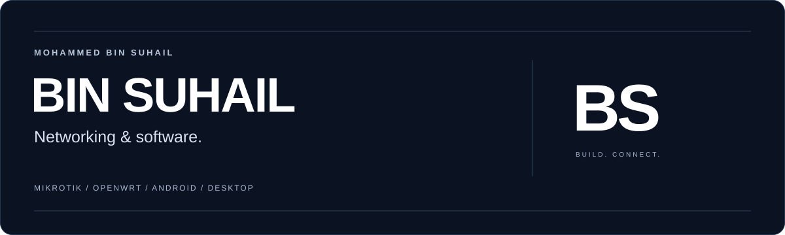
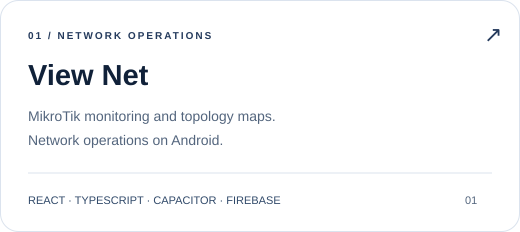
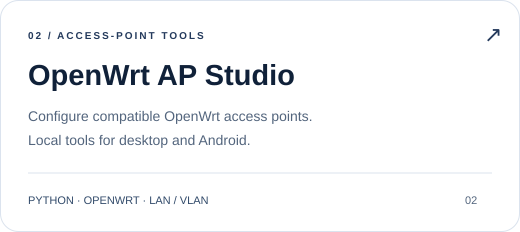

  

  <b>Building tools that connect software to real networks.</b> 
  أدوات برمجية للشبكات، بواجهات عربية وتجربة استخدام واضحة.

  <a href="https://github.com/Bin-Suhail/View-Net">View Net</a> &nbsp; · &nbsp;
  <a href="https://github.com/Bin-Suhail/openwrt-ap-studio">OpenWrt AP Studio</a> &nbsp; · &nbsp;
  <a href="https://github.com/Bin-Suhail?tab=repositories">All repositories</a>

### Selected work

  
  

### Tools I build with

  

  NETWORKING &nbsp; / &nbsp; ANDROID &amp; DESKTOP &nbsp; / &nbsp; ARABIC INTERFACES

