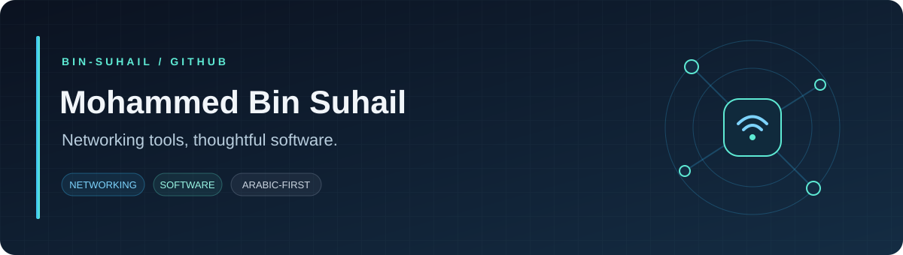

  

  <strong>Networking tools · Desktop &amp; Android · Arabic-first experiences</strong>

  <a href="https://github.com/Bin-Suhail/openwrt-ap-studio">Featured project</a> &nbsp; / &nbsp;
  <a href="https://github.com/Bin-Suhail/openwrt-ap-studio/releases/latest">Downloads</a> &nbsp; / &nbsp;
  <a href="https://github.com/Bin-Suhail?tab=repositories">Repositories</a>

---

### Hello, I'm Mohammed

I build practical tools that make networking tasks easier to understand and manage. My public work brings together OpenWrt, Python, and desktop and Android interfaces, with a focus on Arabic usability and clear configuration workflows.

### أهلًا، أنا محمد بن سهيل

أطوّر أدوات عملية لتبسيط إعداد الشبكات وإدارتها، وأهتم ببناء واجهات عربية واضحة وتجربة استخدام منظّمة على الكمبيوتر وأندرويد.

### Featured project

#### [OpenWrt AP Studio ↗](https://github.com/Bin-Suhail/openwrt-ap-studio)

Desktop and Android tools for configuring compatible OpenWrt routers as access points.

| Built for | What it offers |
| :--- | :--- |
| **Clear setup** | Arabic interface and customizable network templates |
| **Local use** | Works over a local connection, without a cloud account |
| **Careful changes** | Read-only inspection, change review, backups, and rollback checks |
| **Multiple devices** | Windows, Linux, macOS, and Android |

**[Explore the source](https://github.com/Bin-Suhail/openwrt-ap-studio)** &nbsp; · &nbsp; **[Get the latest release](https://github.com/Bin-Suhail/openwrt-ap-studio/releases/latest)** &nbsp; · &nbsp; **[الدليل العربي](https://github.com/Bin-Suhail/openwrt-ap-studio/blob/main/docs/README_AR.md)**

### In my public work

  

- **Networking:** access points, Wi-Fi configuration, and VLAN workflows.
- **Software:** shared Python logic across desktop and Android tools.
- **Experience:** Arabic interfaces, readable settings, and review before applying changes.

---

  Practical tools. Clear interfaces. Built around real tasks.

